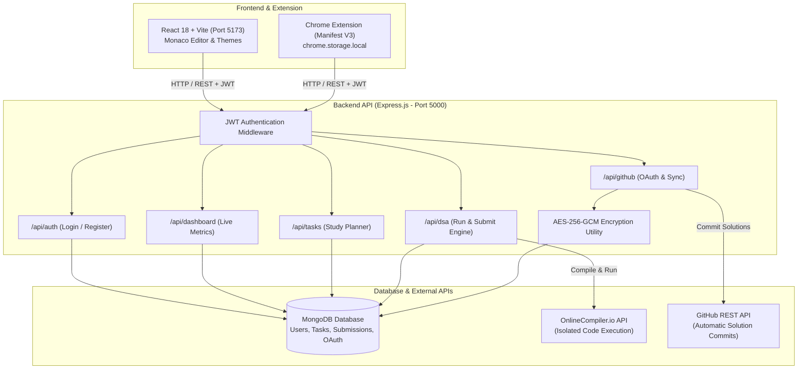

<div align="center">

# 📚 MyDesk

### *All-in-One Student Productivity & Campus Placement Preparation Platform*

A modern, full-stack web platform and Chrome Extension engineered to help computer engineering students streamline daily academic planning, practice Data Structures & Algorithms with real-time compilation, prepare for core technical interviews, and automatically synchronize verified code solutions to their personal GitHub repositories.

<br />


<br />

[Quick Links](#quick-links) • [About MyDesk](#about-mydesk) • [Features](#main-features) • [Tech Stack](#technology-stack) • [Architecture](#architecture) • [Project Structure](#project-structure) • [Installation](#installation-and-setup) • [Chrome Extension](#chrome-extension-setup) • [Screenshots](#screenshots)

---

</div>

<a id="quick-links"></a>
## 📌 Quick Links

- **Repository**: [https://github.com/Ragini-telange/MyDesk](https://github.com/Ragini-telange/MyDesk)
- **Features Overview**: Jump to [Main Features](#main-features)
- **Installation Guide**: Jump to [Installation and Setup](#installation-and-setup)
- **Folder Structure**: Jump to [Project Structure](#project-structure)
- **Browser Extension**: Jump to [Chrome Extension Setup](#chrome-extension-setup)
- **Theme Support**: Jump to [Dark & Light Themes](#theme-support)

---

<a id="about-mydesk"></a>
## 🎯 About MyDesk

Engineering students often struggle with juggling multiple disparate tools during placement preparation: one platform for daily study tasks, another for solving algorithmic problems, separate browser tabs for interview cheat sheets, and manual effort to maintain a coding portfolio on GitHub.

**MyDesk** solves this by unifying everything into a single, cohesive developer workspace:

1. **Daily Academic Planning**: Manage tasks, set study priorities, and organize semester goals.
2. **Interactive Coding Workspace**: Solve 100 hand-picked DSA problems inside an integrated Monaco editor (the engine behind VS Code) with multi-language starter templates.
3. **Automated Solution Verification**: Compile and run code instantly via OnlineCompiler.io, evaluating solutions against both sample and hidden test cases.
4. **Hands-Free GitHub Portfolio**: When a solution receives an **Accepted** verdict, MyDesk automatically commits the source code, generates a comprehensive problem README, and updates a root index on the student's connected GitHub profile.
5. **Technical Interview Preparation**: Rapid revision of core CS concepts across DBMS, Operating Systems, Computer Networks, and Object-Oriented Programming.
6. **Chrome Extension**: Quick-access popup to view daily task completion, DSA stats, and navigate directly into the platform.

---

<a id="main-features"></a>
## 🚀 Main Features

| Icon | Feature | Description |
|:---:|:---|:---|
| 🔐 | **Authentication & Security** | Secure student registration and login with bcryptjs password hashing and signed JSON Web Tokens (JWT). Protected route wrappers prevent unauthorized access. |
| 📊 | **Real-Time Dashboard** | Central command center aggregating live metrics: total & completed study tasks, DSA questions solved vs. attempted, and active GitHub synchronization status. |
| 📝 | **To-Do List & Planner** | Task manager supporting priority classification (High, Medium, Low), category tags, completion checkboxes, and individual task deletion. |
| 💻 | **DSA Practice (100 Questions)** | Curated catalog spanning Arrays, Strings, Linked Lists, Trees, Graphs, Dynamic Programming, and more. Filterable by difficulty, topic, and solved status with pagination. |
| ⚡ | **Online Code Execution** | Integrated Monaco Editor supporting **C**, **C++**, **Java**, and **Python**. Execute code safely through an isolated OnlineCompiler.io backend driver. |
| 🧪 | **Hidden Test Evaluation** | Two-tiered execution engine: "Run Code" executes against public test cases; "Submit Code" evaluates hidden verification suites and updates student records. |
| 🐙 | **GitHub Synchronization** | Seamless OAuth 2.0 integration. Accepted solutions are uploaded automatically to a dedicated repository (`/{Topic}/{Problem}.{ext}`) with structured README documentation. |
| 🛡️ | **AES-256-GCM Token Encryption** | Student GitHub OAuth access tokens are encrypted at rest using AES-256-GCM before storage in MongoDB, safeguarding user credentials. |
| 🧩 | **Chrome Extension (Manifest V3)** | Lightweight browser extension providing popup access to live task counters, DSA progress, and direct navigation links to platform modules. |
| 🌓 | **Dark & Light Mode** | Fully responsive themes powered by CSS Custom Properties. Automatically synchronizes Monaco editor themes (`vs-dark` / `light`) and persists preferences via `localStorage`. |
| 🎯 | **Technical Interview Prep** | Curated question bank covering Core CS subjects (DBMS, OS, CN, OOP) with searchable topics and interactive accordion answer reveals. |

---

<a id="technology-stack"></a>
## 🛠️ Technology Stack

### Frontend
- **Library**: [React 18.3](https://react.dev/)
- **Build Tool**: [Vite 6.0](https://vitejs.dev/)
- **Routing**: [React Router v7](https://reactrouter.com/)
- **Code Editor**: [@monaco-editor/react 4.7](https://github.com/suren-atoyan/monaco-react) (VS Code Editor Engine)
- **Styling**: Vanilla CSS3 with Custom Properties (Variables) & Flexbox/Grid

### Backend
- **Runtime**: [Node.js](https://nodejs.org/) (v18+)
- **Framework**: [Express.js 4.21](https://expressjs.com/)
- **CORS**: [cors 2.8](https://github.com/expressjs/cors)
- **Configuration**: [dotenv 16.4](https://github.com/motdotla/dotenv)

### Database & Storage
- **Database**: [MongoDB](https://www.mongodb.com/) (Local Community Server or Atlas Cloud)
- **Object Modeling**: [Mongoose 8.9](https://mongoosejs.com/)

### Authentication & Cryptography
- **Session Tokens**: [jsonwebtoken 9.0 (JWT)](https://github.com/auth0/node-jsonwebtoken)
- **Password Security**: [bcryptjs 3.0](https://github.com/dcodeIO/bcrypt.js)
- **Token Encryption**: Node.js native `crypto` module (AES-256-GCM with unique IVs and authentication tags)

### Code Execution & Cloud APIs
- **Remote Compiler API**: [OnlineCompiler.io](https://onlinecompiler.io/) (Judge0-compatible REST endpoint)
- **Version Control API**: [GitHub REST API v3](https://docs.github.com/en/rest) (OAuth 2.0 user-to-server flow)

### Browser Extension
- **Platform**: Google Chrome Extension (Manifest V3)
- **Stack**: Plain HTML5, CSS3, Vanilla JavaScript (ES6+)
- **Storage**: `chrome.storage.local` (isolated from browser web context)

---

<a id="architecture"></a>
## 🏗️ Architecture

### System Flow Diagram



### Architectural Highlights
- **Stateless Authentication**: Requests authenticate via `Authorization: Bearer <token>`. The backend verifies the JWT and decodes `req.user._id` without trusting client-supplied identifiers.
- **Sandboxed Compilation**: Student code is never executed directly on the host server. All execution payloads are Base64-encoded and sent to OnlineCompiler.io.
- **Secure OAuth Storage**: GitHub access tokens are encrypted with AES-256-GCM before entering MongoDB and decrypted only in-memory during sync calls.

---

<a id="project-structure"></a>
## 📂 Project Structure

```text
MyDesk/
├── client/                     # Frontend Application (React + Vite)
│   ├── dist/                   # Production build output
│   ├── src/
│   │   ├── components/         # Reusable UI components
│   │   │   ├── Layout.jsx      # Workspace wrapper (Navbar + Sidebar)
│   │   │   ├── Navbar.jsx      # Top navigation & Light/Dark toggle
│   │   │   ├── ProtectedRoute.jsx # Route-guard checking JWT auth
│   │   │   └── Sidebar.jsx     # Student workspace navigation
│   │   ├── context/            # Global React state providers
│   │   │   ├── AuthContext.jsx # Authentication & session state
│   │   │   └── ThemeContext.jsx# Dark/Light theme state & persistence
│   │   ├── data/               # Static course & catalog definitions
│   │   │   ├── dsaQuestions.js # 100 curated DSA problems & test cases
│   │   │   └── interviewData.js# Core CS technical interview questions
│   │   ├── pages/              # Top-level page views
│   │   │   ├── Dashboard.jsx   # Student progress & metrics hub
│   │   │   ├── DsaPractice.jsx # Monaco IDE & test execution console
│   │   │   ├── GitHubIntegration.jsx # OAuth setup & sync controls
│   │   │   ├── Home.jsx        # Landing page
│   │   │   ├── InterviewPrep.jsx# Technical interview preparation
│   │   │   ├── Login.jsx       # Student sign-in
│   │   │   ├── Register.jsx    # Student account registration
│   │   │   └── TodoList.jsx    # Task manager & planner
│   │   ├── App.css             # Comprehensive application styles
│   │   ├── App.jsx             # Router configuration & providers
│   │   ├── index.css           # Global resets & CSS theme variables
│   │   └── main.jsx            # React root entry point
│   ├── index.html              # HTML shell
│   ├── package.json            # Client dependencies & scripts
│   └── vite.config.js          # Vite configuration
│
├── server/                     # Backend API Server (Node.js + Express)
│   ├── config/
│   │   └── db.js               # MongoDB connection handler
│   ├── data/
│   │   └── dsaQuestions.json   # Server-side DSA verification test cases
│   ├── middleware/
│   │   └── auth.js             # JWT verification middleware
│   ├── models/                 # Mongoose schemas
│   │   ├── GitHubIntegration.js# Encrypted OAuth tokens & repo configs
│   │   ├── Submission.js       # Solved/Attempted evaluation records
│   │   ├── Task.js             # To-Do list items
│   │   └── User.js             # Student account credentials
│   ├── routes/                 # Express REST endpoints
│   │   ├── auth.js             # Registration & login handlers
│   │   ├── dashboard.js        # Aggregated progress statistics
│   │   ├── dsa.js              # Run & Submit evaluation handlers
│   │   ├── github.js           # OAuth handshake & repository management
│   │   └── tasks.js            # Task CRUD operations
│   ├── utils/                  # Helper utilities
│   │   ├── encryption.js       # AES-256-GCM encrypt/decrypt routines
│   │   └── githubSync.js       # Git tree manipulation & markdown builders
│   ├── .env.example            # Environment variable template
│   ├── package.json            # Server dependencies & scripts
│   └── server.js               # Express application entry point
│
├── extension/                  # Chrome Extension (Manifest V3)
│   ├── icons/                  # High-DPI extension icons (16, 48, 128 px)
│   ├── generate-icons.js       # Standalone Node script to generate PNG assets
│   ├── manifest.json           # Manifest V3 configuration & permissions
│   ├── popup.css               # Clean teal-accent popup styles
│   ├── popup.html              # Extension interface template
│   └── popup.js                # Extension controller & storage logic
│
├── .gitignore                  # Git ignore rules (node_modules, .env, etc.)
└── README.md                   # Project documentation
```

---

<a id="installation-and-setup"></a>
## 💻 Installation and Setup

### Prerequisites
- [Node.js](https://nodejs.org/) (v18.0.0 or higher recommended)
- [Git](https://git-scm.com/)
- [MongoDB](https://www.mongodb.com/) installed locally or a free [MongoDB Atlas](https://www.mongodb.com/atlas) connection string
- A free [OnlineCompiler.io](https://onlinecompiler.io/) API key

---

### Step 1: Clone the Repository

```bash
git clone https://github.com/Ragini-telange/MyDesk.git
cd MyDesk
```

---

### Step 2: Configure Backend Environment Variables

1. Navigate to the `server/` directory:
   ```bash
   cd server
   ```
2. Copy the template file to create your local `.env`:
   ```bash
   # Windows PowerShell
   Copy-Item .env.example .env

   # Or Command Prompt
   copy .env.example .env
   ```
3. Open `server/.env` in your text editor and fill in your private values:
   ```env
   PORT=5000
   MONGODB_URI=mongodb://127.0.0.1:27017/mydesk
   JWT_SECRET=your_long_random_jwt_secret_key_here
   JWT_EXPIRE=7d

   # OnlineCompiler.io Credentials (Free tier)
   ONLINECOMPILER_API_URL=https://api.onlinecompiler.io/api/judge0
   ONLINECOMPILER_API_KEY=your_onlinecompiler_api_key_here

   # GitHub OAuth Credentials (from GitHub Developer Settings)
   GITHUB_CLIENT_ID=your_github_client_id_here
   GITHUB_CLIENT_SECRET=your_github_client_secret_here
   GITHUB_CALLBACK_URL=http://localhost:5000/api/github/callback
   CLIENT_URL=http://localhost:5173

   # 64-character Hex Key for AES-256-GCM Token Encryption
   # Generate via: node -e "console.log(require('crypto').randomBytes(32).toString('hex'))"
   ENCRYPTION_KEY=your_64_character_hex_key_here
   ```

---

### Step 3: Install Dependencies

```bash
# Install Server Dependencies
cd server
npm install

# Install Client Dependencies
cd ../client
npm install
```

---

### Step 4: Run the Application

Open two terminal windows:

**Terminal 1 — Start the Backend Server**:
```bash
cd server
npm run dev
```
*The backend server will launch at `http://localhost:5000`.*

**Terminal 2 — Start the React Frontend**:
```bash
cd client
npm run dev
```
*The Vite development server will launch at `http://localhost:5173`.*

Open your browser and navigate to **`http://localhost:5173`** to access MyDesk.

---

<a id="chrome-extension-setup"></a>
## 🧩 Chrome Extension Setup

MyDesk includes an official Chrome Extension (Manifest V3) for checking daily study progress without opening the website:

1. Open Google Chrome and navigate to:
   ```text
   chrome://extensions/
   ```
2. In the top-right corner, turn **Developer mode** **ON**.
3. Click the **Load unpacked** button in the top-left toolbar.
4. Select the `extension/` folder located inside this repository:
   ```text
   C:\path\to\MyDesk\extension
   ```
5. Click **Select Folder**. The **MyDesk** extension card will appear.
6. Click the extension icon in Chrome's toolbar, enter your MyDesk student credentials, and view your live progress.

---

<a id="theme-support"></a>
## 🌓 Theme Support

MyDesk features integrated **Dark Mode** and **Light Mode**:

- **Light Mode**: Crisp, high-contrast white card surfaces, soft slate backgrounds, and clear typography.
- **Dark Mode**: Eye-friendly slate-900 background (`#0f172a`), slate-800 elevated surfaces (`#1e293b`), and vibrant accent colors.
- **Synchronized Editor**: When toggled, the Monaco editor dynamically switches between `vs-dark` and `light` themes.
- **Persistence**: Preferences are stored in `localStorage` under `mydesk_theme` and persist across browser reloads, logouts, and logins.

---

<a id="screenshots"></a>
## 📸 Screenshots

<!--
To add screenshots:
1. Create a folder named "assets/screenshots/" in the project root.
2. Save your screenshots with the filenames shown below.
3. Uncomment the image links to display them on GitHub.
-->

### 🖥️ Platform Showcase

| View | Screenshot |
|:---|:---:|
| **Landing Page** | <!--  --> *[Screenshot Placeholder: Landing Page with feature overview]* |
| **Student Dashboard** | <!--  --> *[Screenshot Placeholder: Real-time student progress & stats]* |
| **To-Do Planner** | <!--  --> *[Screenshot Placeholder: Task manager with priority tags]* |
| **Monaco DSA Workspace** | <!--  --> *[Screenshot Placeholder: Split-screen coding IDE & test output]* |
| **Interview Preparation** | <!--  --> *[Screenshot Placeholder: Core CS subjects & question bank]* |
| **GitHub Integration** | <!--  --> *[Screenshot Placeholder: OAuth connection & synced solution counter]* |
| **Dark Theme** | <!--  --> *[Screenshot Placeholder: Comfortable night-mode palette]* |
| **Chrome Extension** | <!--  --> *[Screenshot Placeholder: Manifest V3 popup widget]* |

---

<a id="future-scope"></a>
## 🔮 Future Scope (Planned Enhancements)

The following capabilities are planned for upcoming iterations of MyDesk:
- [ ] **Mock Interview Timer**: Configurable mock technical interview sessions with countdown timers.
- [ ] **Peer Discussion Forum**: Problem-specific discussion boards for students to share alternative algorithmic approaches.
- [ ] **Company-Specific Tags**: Filtering DSA questions by target placement companies (e.g., TCS, Infosys, Amazon, Microsoft).
- [ ] **Resume Keyword Scanner**: Basic ATS keyword evaluator comparing student project descriptions with placement job descriptions.

---

<a id="contributors"></a>
## 👥 Contributors

- **Ragini Telange** ([@Ragini-telange](https://github.com/Ragini-telange)) — *Full Stack Development & Project Architecture*

---

## 📄 License

This project is developed as an academic and placement preparation platform. Feel free to use and adapt it for learning purposes.

<div align="center">
  <sub>Built with ❤️ by Ragini Telange for computer engineering students and campus placement aspirants.</sub>
</div>
